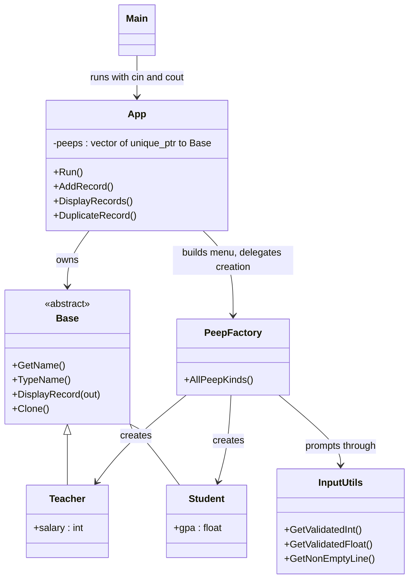
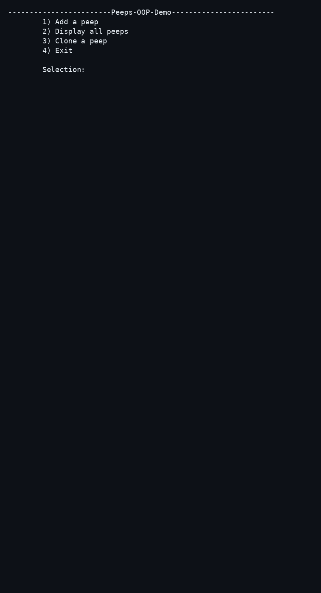
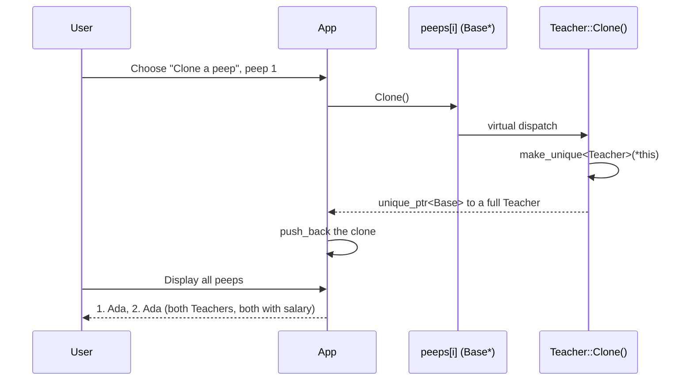

# Peeps-OOP-Demo

[](https://github.com/enonymous1/Peeps-OOP-Demo/actions/workflows/ci.yml)
[](LICENSE)
[](CMakeLists.txt)

## Description

Peeps-OOP-Demo is a tiny console app that teaches the one OOP idea
textbooks usually hand-wave: **cloning a polymorphic object without
slicing it**.

You add Teachers and Students, display them, and clone one. The clone
keeps its real type — a cloned Teacher is still a Teacher, with its
salary intact — even though the list only ever holds
`unique_ptr<Base>`. Everything else in the program exists to make that
one idea easy to read.

What it teaches:

- Inheritance and polymorphism through an abstract `Base` class
- Polymorphic cloning via a virtual `Clone()` method (the prototype
  pattern, in miniature)
- Ownership with `std::unique_ptr` — no raw `new` / `delete` anywhere
- Separating the record model from console I/O, so the model is
  testable without a terminal



## Prerequisites

- A C++17 compiler: a recent GCC, Clang, or MSVC. CI builds on
  Ubuntu, Windows, and macOS with their current toolchains.
- CMake 3.27 or newer (presets require 3.23+, and the project declares
  3.27).
- No libraries to install. The program and its tests have zero
  dependencies, so the build works offline.

## Installation

Download a prebuilt binary from the GitHub Release (starting with
v2.1.1): pick the zip for your platform (`linux-x64`, `windows-x64`,
`macos-arm64`), unzip it, and run `Peeps_OOP_Demo`
(`Peeps_OOP_Demo.exe` on Windows). Each zip holds only the binary and
the LICENSE, so no toolchain is needed. The binaries are unsigned, so
Windows may show a SmartScreen warning and macOS may block the first
run; on macOS, clearing the quarantine flag lets it run:

```sh
xattr -d com.apple.quarantine Peeps_OOP_Demo
```

Or build from source with the release preset, then install the binary:

```sh
cmake --preset release
cmake --build --preset release
cmake --install out/build/release
```

By default `cmake --install` puts `Peeps_OOP_Demo` in
`/usr/local/bin`. To install elsewhere, add a prefix:

```sh
cmake --install out/build/release --prefix ~/peeps
```

Then run it:

```sh
Peeps_OOP_Demo
```

On Windows the built binary is
`out/build/release/Release/Peeps_OOP_Demo.exe` before installing, and
`cmake --install` places it in the prefix's `bin` directory.

## Local Development

Use the debug preset while working on the code. It is the same build
with debug info and no optimisation:

```sh
cmake --preset debug
cmake --build --preset debug
```

Run the tests with the test preset (or the manual `ctest` command
after it):

```sh
ctest --preset test
# Equivalent manual form:
ctest --test-dir out/build/release -C Release --output-on-failure
```

The tests are a single zero-dependency binary (`tests/test_peeps.cpp`,
run via CTest). They cover clone type/field preservation and
independence, setter range invariants, input validation (invalid,
out-of-range, trailing junk), EOF handling, and a full scripted app
session. If you change behaviour, add a test for it in the same change.

Compiler warnings are on (`-Wall -Wextra -Wpedantic`, `/W4` on MSVC)
but are not errors in a local build, so a warning on another compiler
does not block trying the demo. Please still fix warnings you
introduce.

Formatting follows `.clang-format` (LLVM style, 4-space indent,
100-column limit). Format changed files before submitting:

```sh
clang-format -i include/*.h src/*.cpp tests/*.cpp
```

There is no format check in CI yet, so this step is on the contributor
for now.

To contribute: build with the debug preset, run `ctest --preset test`,
format your changes, and keep the program's scope in mind — this is a
teaching demo, not a database (see Non-goals below).

## Deployment

There is no hosted deployment for this project, and that is
deliberate: it is a console program, not a service or a website.

The deployment path is a GitHub Release:

1. Push to `main`. CI builds and tests on Ubuntu, Windows, and macOS.
2. Tag the release on `main` (for example `v2.1.1`, matching the
   version in `CMakeLists.txt`), then push the tag. Push the tag
   *after* pushing `main`: the release workflow has to be in the
   tagged commit to run at all, and tag pushes do not trigger CI, so
   the release workflow runs the test suite itself.
3. Pushing the tag triggers `.github/workflows/release.yml`: it
   checks the tag matches the `CMakeLists.txt` version, builds on
   Ubuntu, Windows, and macOS, and creates a GitHub Release with one
   zip per platform (binary + LICENSE) plus `SHA256SUMS.txt`. Tags
   with a `-` suffix (for example `v2.1.2-rc1`) are pre-releases.
   Prebuilt binaries start with v2.1.1; earlier releases were
   source-only.
4. Users without a toolchain use a prebuilt zip; everyone else can
   build from source with the Installation commands above.

There is no package-registry distribution. The release is identified
by its tag and zip names; there is no `--version` flag yet, and that
is not a blocker for the binary releases — it remains a future
addition, not a requirement.

## Usage

The menu has four options:

1. Add a peep (Teacher with a salary, or Student with a GPA)
2. Display all peeps, numbered
3. Clone a peep by number
4. Exit

Input is validated: non-numeric input and out-of-range values are
rejected and re-prompted, and end-of-input (Ctrl-D, or a piped file
running out) exits cleanly instead of looping forever.

## Sample session



The GIF above was rendered from a real terminal session with the
same script as the transcript below — it is the program's actual
output, not typed-out text. The transcript follows as the
accessible, searchable text version:

This is a real interactive session captured through a terminal, so
the typed input is shown after each prompt (add a teacher, display,
clone, display again, exit):

```
------------------------Peeps-OOP-Demo------------------------
	1) Add a peep
	2) Display all peeps
	3) Clone a peep
	4) Exit

	Selection: 1
------------------------What kind of peep?------------------------

		1) Teacher
		2) Student

	Selection: 1
------------------------Name?------------------------
		Name:  Ada

------------------------Salary?------------------------
		Salary:  50000
------------------------Peeps-OOP-Demo------------------------
	1) Add a peep
	2) Display all peeps
	3) Clone a peep
	4) Exit

	Selection: 2
------------------------Display Records------------------------

		1. Ada :: Salary == 50000

------------------------Peeps-OOP-Demo------------------------
	1) Add a peep
	2) Display all peeps
	3) Clone a peep
	4) Exit

	Selection: 3
------------------------Clone a peep------------------------
		There are 1 peeps in the records, choose one to clone.
		Peep number: 1
Cloned peep 1.
------------------------Peeps-OOP-Demo------------------------
	1) Add a peep
	2) Display all peeps
	3) Clone a peep
	4) Exit

	Selection: 2
------------------------Display Records------------------------

		1. Ada :: Salary == 50000

		2. Ada :: Salary == 50000

------------------------Peeps-OOP-Demo------------------------
	1) Add a peep
	2) Display all peeps
	3) Clone a peep
	4) Exit

	Selection: 4
```

## How cloning works

Records live in a `std::vector<std::unique_ptr<Base>>`. Each derived
class implements `Clone()` as `std::make_unique<Derived>(*this)`, so
copying through a `Base` pointer still produces the full derived
object. The return type has to be `unique_ptr<Base>`, not
`unique_ptr<Derived>`: C++ covariant return types do not apply to
`unique_ptr`. Copying through a `Base` value instead would slice the
derived fields away; `Clone()` is the escape hatch.

`DisplayRecord()` takes an output stream, which is also why the
classes are unit-testable without touching the console.



## Tests

```sh
cmake --preset release
cmake --build --preset release
ctest --preset test
```

See Local Development above for the debug workflow and for what the
suite covers.

## Extending the project

To add a new peep type, for example `Manager`:

1. Add `include/Manager.h` inheriting from `Base`, implementing
   `TypeName()`, `DisplayRecord()`, and `Clone()`.
2. Add `src/Manager.cpp`.
3. Add the new source file to the `peeps_core` target in
   `CMakeLists.txt`.
4. Add one entry to the registry in `src/PeepFactory.cpp`: its label
   and a creator that prompts for its fields and returns the finished
   record.

No `App.cpp` edit is needed — `App` builds its type menu from the
registry, so the menu, the factory, and the tests stay in sync. Add
a factory test proving the new type is creatable through
`AllPeepKinds()`.

## Project layout

- `include/` — `App.h`, `Banner.h`, `Base.h`, `InputUtils.h`,
  `PeepFactory.h`, `Student.h`, `Teacher.h`
- `src/` — `main.cpp`, `App.cpp`, `InputUtils.cpp`,
  `PeepFactory.cpp`, `Student.cpp`, `Teacher.cpp`
- `tests/` — `test_peeps.cpp` (zero-dependency test binary, run via
  CTest)
- `docs/assets/` — `demo.gif` (real terminal session, see Sample
  session)
- `CMakeLists.txt`, `CMakePresets.json`, `CHANGELOG.md`
- `.github/workflows/ci.yml`, `.clang-format`, `LICENSE`

## Non-goals

This stays a teaching demo on purpose. It is not a database, it has
no persistence, and there is no delete/edit/search — adding those
would bury the cloning lesson under CRUD code.

## License

MIT, copyright `enonymous1`. See [LICENSE](LICENSE).

## Changelog

See [CHANGELOG.md](CHANGELOG.md) for the full history. In short:
**2.1.0** applies the staff review — bounds as a single source of
truth, whitespace-name and non-finite-input fixes, a `main()` error
catch, a `PeepFactory` registry, `TypeName()`, and this rewritten
README. **2.0.0** was the C++17 modernization: the old tree did not
build under its declared C++14, the EOF hang was fixed, `App` and
input helpers were stream-injected, `clone()` became `Clone()`, and
tests, CI, and the MIT LICENSE were added.
